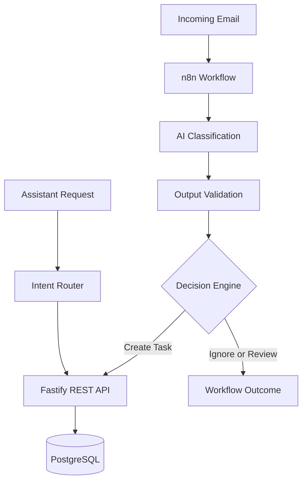

# TaskMail

**AI-powered email processing and task management — a personal software development project.**

TaskMail is an application I'm independently developing to help users turn incoming emails into organized, actionable tasks.

The idea came from a common problem in everyday business operations: important messages can easily get lost among newsletters, notifications, and routine emails.

My goal is to build a practical tool that identifies what needs attention and makes daily communication easier to manage.

## How it works

## Architecture

TaskMail is being developed around a workflow that:

- Receives and processes incoming emails.
- Uses AI to classify messages and identify possible actions.
- Validates AI responses against defined rules.
- Creates tasks and stores them in PostgreSQL.
- Provides a backend API for retrieving and managing task data.
- Uses an intent router to answer supported task-related questions.

## Tech Stack

| Area | Technologies |
|---|---|
| Backend | JavaScript, Node.js, Fastify |
| Database | PostgreSQL, SQL |
| AI & Automation | n8n, OpenAI API |
| Infrastructure | Linux, Docker |
| Development | Git, GitHub, REST APIs |

## Current Development Status

**Working components:**
- Email processing and AI classification workflow
- AI output validation and decision rules
- PostgreSQL task storage
- Fastify backend and database integration
- Rule-based intent routing for pending, completed, and urgent tasks
- Validation tests with sample data

**Next steps:**
- Web dashboard for task management
- Improved API validation and error handling
- End-to-end testing and reliability improvements
- Controlled AI fallback for more complex questions
- Private beta testing

## Project Background

I'm developing TaskMail while transitioning from business operations and department management into software development.

The project gives me the opportunity to work on real backend challenges, API integrations, databases, automation, and application architecture.

I'm focused on learning through building, testing, debugging, and improving the application step by step.

## Source Code

This repository is a public showcase of the project.

The main application source code is maintained in a separate private repository while development continues.

*TaskMail is currently under active development and is not yet a publicly available product.*
